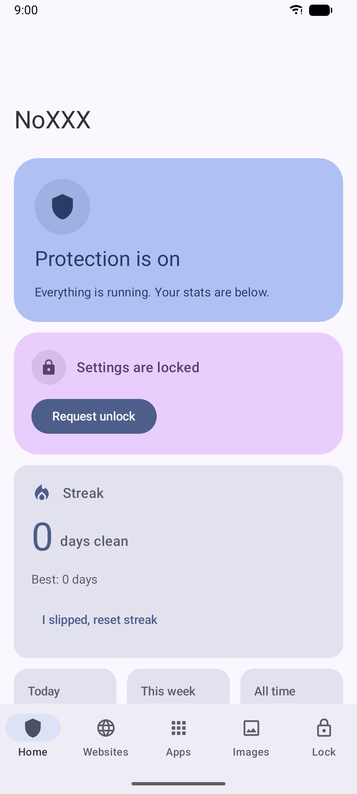
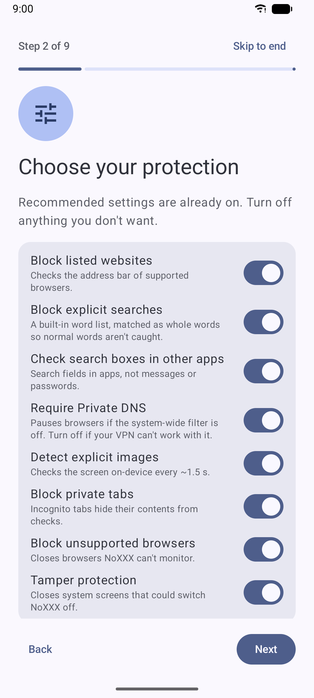
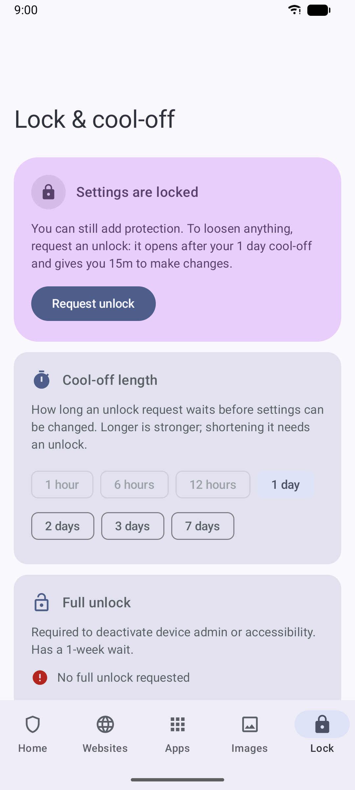

# NoXXX: free porn blocker for Android

**NoXXX is a free, open-source porn blocker and NSFW filter for Android.** It blocks adult websites,
explicit searches and explicit images on your own phone, and it's built to be hard to switch off on
impulse: loosening any setting means waiting out a cool-off you choose, from 1 hour to 7 days. It works
without a VPN, needs no account, and runs entirely on your phone, so nothing about what you browse
ever leaves it.

It's for anyone who wants to quit porn or cut back, whether for recovery, NoFap, faith, a relationship
or their mental health, and wants a blocker that still holds when an urge hits.

**[Download the latest APK](https://github.com/Benbone21/NoXXX/releases/latest)** · Android 9 or newer

<p>
  
  
  
</p>

## Why NoXXX

- **Free and open source:** no subscription, no ads, no tracking. Licensed under GPL-3.0.
- **No VPN needed:** it uses Android's built-in Private DNS, so it runs alongside a VPN you already use.
- **Several layers at once:** a family-filter DNS, a list of about 77,000 adult sites, explicit-search
  blocking, on-device image detection, and blocking for any app you choose.
- **Hard to turn off in a weak moment:** a cool-off before any change, a lockdown mode that can't be
  shortened, and an optional accountability partner password.
- **Private:** no account and no cloud. Screens checked for explicit images are never saved or uploaded.

> **Note:** This app was generated by AI (Claude), then carefully reviewed, refined, and personally
> used by the developer to ensure it works well. It has been tested on a Samsung Galaxy S24
> (Android 15); other devices may work but aren't guaranteed.

## How it works

| Layer | How it works |
|---|---|
| **Websites** | Android's Private DNS is pointed at a family filter (Cloudflare for Families by default), which filters every app. CleanBrowsing Family also forces SafeSearch, but its servers can fail to load normal sites such as Canvas and Okta logins. On top of that, supported browsers' address bars are checked against a bundled list of 76,798 domains, plus your own sites and words. |
| **Searches** | A built-in list of blocked words and phrases (plus your own) is checked against browser address bars and search boxes in other apps. Matching is whole-word only, so a blocked word inside a longer, normal word never triggers. A blocked search is cleared. |
| **Images** | On Android 11+, a shrunken copy of the screen is classified on-device about every 1.5 s by a MobileNetV2 model. If it detects explicit content, the screen is covered and the app is sent back. Nothing is saved or uploaded. |
| **Apps** | Pick any apps to block. Browsers NoXXX can't monitor, and private/incognito tabs, can also be blocked. |
| **Two-tier unlock** | Once protection starts, Home, stats and history stay open, and adding protection always works. **Settings unlock** (1 h to 7 d cool-off, 24 h default) opens a 15-minute window to edit NoXXX settings; TamperShield stays active so system settings are still guarded. **Full unlock** (7-day cool-off) opens a 15-minute window where TamperShield is off, allowing device admin deactivation and uninstall. An unlock request expires if not opened within 15 minutes of being ready. |
| **Lockdown** | Freezes every setting and pauses unlock requests for 1–90 days. It can be extended but not shortened. |
| **Partner** | Optional, and only during setup. An accountability partner's password opens an unlock immediately and ends lockdown. Once protection starts, a partner can't be added (not even in an unlock window), so you can't give yourself one later to skip the cool-off. |
| **Tamper protection** | While settings are locked, only screens that can switch NoXXX off are closed: its own Accessibility page, its App info (Force stop, Uninstall, Clear storage), "Stop NoXXX?" dialogs, device-admin deactivation, the uninstall prompt and the Private DNS dialog. Lists that just include NoXXX (the Accessibility list, app lists, battery and notification lists) stay usable. A locked screen is left with Back plus a short message, so you stay in Settings where you were. Device admin blocks a plain uninstall. |
| **Stats** | Current and best streak, blocks today / this week / all time, a 7-day chart and a breakdown by type. |
| **Extras** | Block history, optional app PIN. |
| **Look** | Material You (Material 3): colors follow your wallpaper on Android 12+, light/dark follows the system, themed launcher icon. |

## Install

1. Download the APK from the [latest release](https://github.com/Benbone21/NoXXX/releases/latest).
2. Allow your browser or file manager to install unknown apps when Android asks, then open the APK.
3. Follow the setup guide that opens on first launch.

Official releases are signed with this certificate (SHA-256). Apps like
[AppVerifier](https://github.com/soupslurpr/AppVerifier) can check it:

```
7F:A4:C1:3C:0C:AD:21:F6:7D:00:85:65:70:D8:33:D7:6C:3D:3A:FD:28:08:B3:86:0F:F4:02:9F:A5:E7:43:07
```

## Build

Needs JDK 17 or newer and the Android SDK. Android Studio is optional; everything builds from the command line.

```
./gradlew assembleDebug          # app/build/outputs/apk/debug/app-debug.apk
./gradlew testDebugUnitTest      # unit tests
./gradlew assembleRelease        # app/build/outputs/apk/release/
```

The release APK is only signed when a key is configured outside the repository, in
`~/.gradle/gradle.properties` or as environment variables:

```
NOXXX_STORE_FILE=/path/to/release.jks
NOXXX_STORE_PASSWORD=...
NOXXX_KEY_ALIAS=noxxx
NOXXX_KEY_PASSWORD=...
```

Without them, `assembleRelease` produces an unsigned APK (this is what F-Droid builds and signs itself).

Toolchain: AGP 8.13.2, Gradle 8.13, Kotlin 2.1.0, compileSdk/targetSdk 35, minSdk 28 (Android 9).
Image detection needs Android 11 (API 30) or newer.

## Phone setup

The first time NoXXX opens, a **setup guide** walks through everything one step at a time:
choosing your protections, each permission, apps to block, your cool-off and an optional partner
password. Until you tap **Start protection**, the app is in setup mode: every change applies instantly,
nothing is locked, and you can reopen the guide from the checklist icon on the Home tab. After that the
guide is gone; anything that gets switched off can be fixed from the Setup card on Home.

The guide covers:

1. **Accessibility service**: turn on *NoXXX*.
   On Android 13+, a sideloaded app's switch may be greyed out. Open *App info → ⋮ → Allow restricted settings*, then try again.
2. **Private DNS**: *Settings → Network & internet → Private DNS → Private DNS provider hostname* →
   `family.cloudflare-dns.com` (or another provider listed on the Websites tab).
3. **Auto-repair (optional)**: from a computer, run
   `adb shell pm grant com.noxxx.guard android.permission.WRITE_SECURE_SETTINGS`.
   NoXXX can then switch Private DNS back on by itself if it gets changed.
4. **Uninstall protection**: turn on device admin.
5. **Battery**: let NoXXX ignore battery optimization so it isn't stopped in the background.
6. Set up the Websites, Apps, Images and Lock tabs, then tap **Start protection**.

### Using your own VPN

Private DNS and a VPN usually coexist, but some VPN apps send DNS through their own servers instead.
With your VPN connected, check the Home tab:

- **"Private DNS: family.cloudflare-dns.com" shown**: you're covered.
- **Not filtering**: either set your VPN app's custom DNS to a family filter (Cloudflare for Families
  `1.1.1.3` / `1.0.0.3`, or CleanBrowsing Family `185.228.168.168` / `185.228.169.168`), or turn off
  *Require Private DNS* on the Websites tab. Address-bar checking and image detection keep working
  either way. Do this during setup mode so it doesn't have to wait out the cool-off.

### Custom filter: allow sites the family filters block

Family filters treat some non-adult sites as adult, torrent indexes for example. To allow them while
still blocking porn, use your own filter:

1. Make a free profile at [NextDNS](https://nextdns.io) (or [Control D](https://controld.com)) and turn on
   porn blocking (NextDNS: *Parental Control → Porn*).
2. Add the sites you need to the profile's **Allowlist**.
3. In NoXXX, choose **Custom filter** on the Websites tab and paste the profile's DNS-over-TLS hostname
   (like `abc123.dns.nextdns.io`). Also add the sites under **Allowed sites**, since NoXXX's own list may
   block them too.

NoXXX checks every few minutes that the custom filter still blocks well-known adult sites. If porn
blocking gets switched off in the profile, NoXXX treats Private DNS as off: browsers pause until it's
fixed. Switching to a custom filter, or allowing sites, needs an unlock once protection has started.

## How word blocking avoids false positives

- Text is decoded (`+`, `%20`), lowercased and split into words. A term matches only as a whole word,
  or as a whole phrase in order. Simple plurals count; parts of words never do.
- Number-for-letter spellings are undone only inside words that mix letters and digits.
- The built-in list (`app/src/main/assets/keywords.txt`) is generated by `scripts/update-keywords.py`.
  It keeps only entries tagged sexual with moderate-or-stronger severity, then drops any single word
  that's among the 10,000 most common ordinary English words, and any word or phrase that appears
  anywhere in a large body of ordinary text (Linux documentation, about 62 million words).
- The list is never displayed in the app. If something normal still gets blocked, add it under
  **Websites → Allowed words**.
- Search boxes in other apps are recognised by their id, hint or type ("search", "query" and so on).
  Message boxes and password fields are skipped.

To rebuild the list: `python3 scripts/update-keywords.py --fetch --exclude-corpus /usr/share/doc`

## How the settings lock works

- **Always allowed:** viewing Home and stats, blocking more sites/apps/words, turning protection on,
  raising sensitivity, lengthening the cool-off, starting a lockdown.
- **Needs an unlock:** anything that loosens protection. Those controls show a lock icon.
- **Settings unlock:** tap *Request unlock* (Home, any settings tab, or the Lock tab). After the
  cool-off it becomes *ready* for 15 minutes; open it to get a **15-minute window** where NoXXX
  settings can be changed. TamperShield stays active, so system settings screens for NoXXX are still
  guarded. Then it locks again.
- **Full unlock:** tap *Request full unlock* (Lock tab). After a 7-day cool-off it becomes ready for
  15 minutes; open it to get a **15-minute window** where TamperShield is off, allowing you to
  deactivate device admin, disable the accessibility service, and uninstall. Use this only when you
  want to fully remove protection.

The timers resist tricks:

- Time is counted with Android's monotonic clock, so changing the date/time doesn't speed it up.
- Time while the phone is switched off is only credited once it can be checked against HTTPS
  `Date` headers on both sides of the reboot. Setting the clock forward and rebooting gains nothing.

## Removing NoXXX

1. Request a **full unlock** (Lock tab) and wait out the 7-day cool-off.
2. Open the full unlock. For the next 15 minutes, TamperShield is off.
3. *Settings → Security → Device admin apps* → turn off NoXXX.
4. Uninstall.

## Limits (be honest with yourself about these)

- **Safe mode, factory reset, or adb** can get around any non-root app. A device-owner build would
  be needed to close those gaps.
- **Force-stopping NoXXX turns its Accessibility service off** (Android does this for every app).
  That's why tamper protection closes App info and Samsung's Device care. If it ever happens,
  turn the service back on from the Home tab.
- Tamper protection recognises dangerous screens by their title and English button labels (Force stop,
  Uninstall, Clear storage, Deactivate, Stop, Turn off). On a phone set to another language, App info may
  not be recognised; NoXXX's own Accessibility page and the uninstall prompt still are.
- Image detection is a statistical model, so expect occasional misses and false alarms. Adjust the
  sensitivity, or skip apps like games to save battery.
- Apps that block screenshots (FLAG_SECURE) can't be scanned. NoXXX detects these in any app and
  blocks them the same way as private browsing, except for security apps like banking, password
  managers, and authenticators which are always exempt. In a browser this is treated as a private tab:
  a fully black screen for about 4.5 s is blocked.
- Browser updates can rename address-bar views. Private DNS still covers browsers when that happens.

## Privacy

Everything runs on the phone. The only network requests NoXXX makes are HEAD requests to
google.com / cloudflare.com, to read the time. DNS goes to whichever Private DNS provider you chose.

## Project layout

```
app/src/main/java/com/noxxx/guard/
  policy/    Policy, cool-off/lockdown engine, tamper-resistant clock, password hashing (pure Kotlin, unit-tested)
  data/      GuardStore (persisted state), BlockLog, NetworkTime
  web/       DomainBlocklist (hashed, ~640 KB RAM), UrlChecker, PrivateDns status/enforcement
  vision/    ImageClassifier (LiteRT), ScreenScanner (accessibility screenshots, tiling)
  monitor/   GuardAccessibilityService, BlockOverlay, BrowserRegistry, TamperGuard
  admin/     Device admin receiver        boot/  Boot receiver
  ui/        Compose UI: Home, Websites, Apps, Images, Cool-off
app/src/main/assets/
  blocklist.txt              domain list (refresh with scripts/update-blocklist.sh)
  nsfw_mobilenet_v2.tflite   image model
```

## Credits

- Domain list: [StevenBlack/hosts](https://github.com/StevenBlack/hosts) adult-content extension (MIT)
- Word list: [dsojevic/profanity-list](https://github.com/dsojevic/profanity-list) (MIT), filtered as described above; [google-10000-english](https://github.com/first20hours/google-10000-english) is used at build time only
- Image model: [GantMan/nsfw_model](https://github.com/GantMan/nsfw_model) MobileNetV2 224 (MIT)
- DNS filtering: [CleanBrowsing](https://cleanbrowsing.org) and [Cloudflare for Families](https://one.one.one.one/family/)

## License

Copyright (C) 2026 Benbone21

NoXXX is free software: you can redistribute it and/or modify it under the terms of the
[GNU General Public License](LICENSE) as published by the Free Software Foundation, either version 3
of the License, or (at your option) any later version. It is distributed in the hope that it will be
useful, but WITHOUT ANY WARRANTY; without even the implied warranty of MERCHANTABILITY or FITNESS FOR
A PARTICULAR PURPOSE. See the [license](LICENSE) for details.

The bundled domain list, word list and image model keep their own MIT licenses (see Credits).

## Keywords

Porn blocker for Android, NSFW blocker, NSFW filter, adult content blocker, block porn on Android,
free porn blocker, open-source porn blocker, porn blocker without VPN, porn filter app, quit porn app,
NoFap app, porn addiction recovery, accountability app, website blocker, app blocker, explicit image
blocker, SafeSearch enforcement, family filter DNS, self-control, digital wellbeing. A free alternative
to paid blockers such as BlockerX, Covenant Eyes and Canopy.
